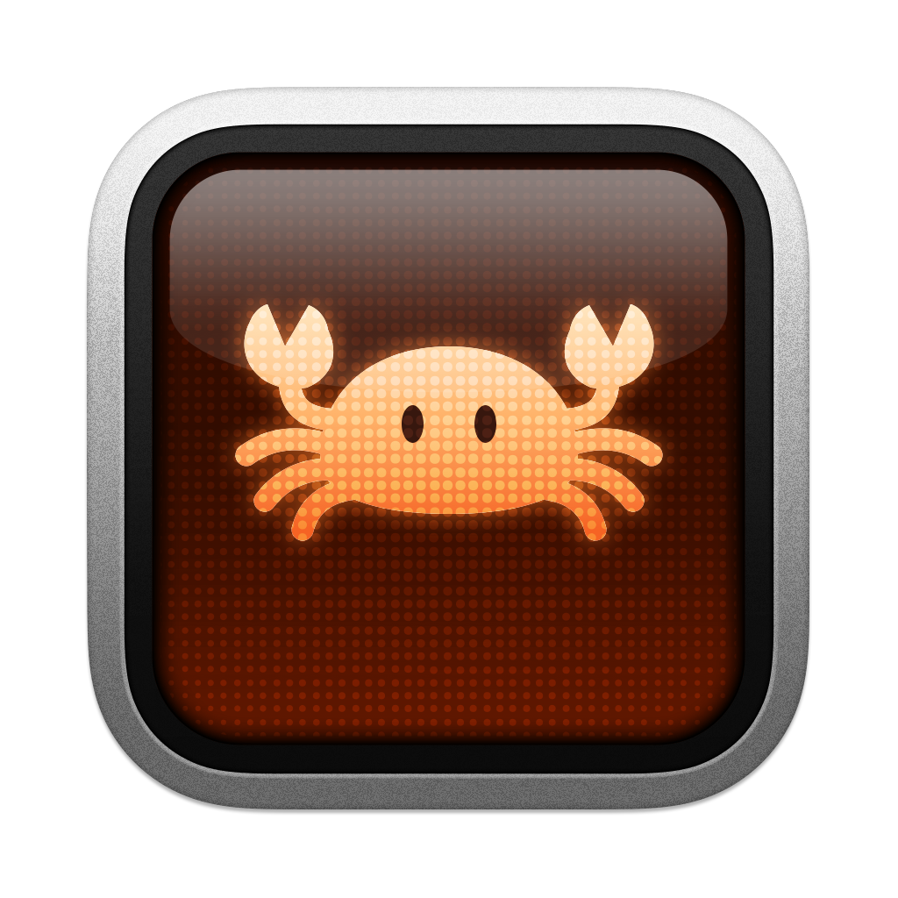

<p align="center">
  
</p>

<h1 align="center">Rustty</h1>

<p align="center">
  A terminal for Byron's development workflow, built in Rust and learning from Ghostty.
</p>

Rustty is a personal terminal project for macOS and Windows, developed under
Byron's direction. It brings together terminal emulation, native desktop
integration, persistent local and remote sessions, and tools for keeping track
of work across many panes. The aim is
simple: spend less time finding the right terminal, rebuilding a workspace, or
checking whether an agent needs attention.

> [!NOTE]
> Rustty is a fully AI-generated personal project. This README was written by
> Codex. No more than one or two people in the world use Rustty; they love it,
> though. :D

**Rustty is not a fork of Ghostty's terminal implementation.** It is an
alternative implementation in Rust that follows
[Ghostty mainline](https://github.com/ghostty-org/ghostty) development closely.
Ghostty's terminal behavior, designs, fixes, and innovations provide the reference;
Rustty adapts them to work natively within the Rust ecosystem, alongside its own
workflow features. The application and terminal libraries do not link Ghostty's
Zig implementation.

This repository retains Ghostty's source and history alongside the Rust workspace
so changes can be studied, tested, and compared directly. Some resources, including
shell integration, themes, and font assets, are reused with their original
licenses. The [upstream review](test/rustty/UPSTREAM-2026-10.md) and
[compatibility checks](test/rustty/README.md) document that work. Following mainline
is an ongoing process, not a claim that every Ghostty feature is already present.

Ghostty makes much of this possible. Rustty draws on that work to serve its users'
development workflows, with respect for Ghostty's design and contributors.

## Built around Byron's workflow

Byron's development work spans projects, worktrees, local shells, remote machines,
and coding agents. The highlighted features below are Rustty additions beyond
Ghostty's desktop features in the
[mainline snapshot](https://github.com/ghostty-org/ghostty/commit/a2e440396)
retained in this checkout. That comparison can change as Ghostty develops.

- **Native Windows desktop with GPU and CPU renderers.** Run Windows shells
  through ConPTY, without WSL. Choose DirectX 12 GPU rendering or software
  rendering through GDI; automatic mode falls back to the CPU if GPU startup
  fails. The same app also runs natively on macOS.
- **Workspace Outliner, fuzzy panel search, and numbered pins.** Find panels
  across windows and tabs, distinguish matching names through breadcrumbs,
  and jump to frequently used panels with configurable pin shortcuts.
- **Quadrant zoom, nested zoom, and temporary peek.** Enlarge a group of panels,
  zoom further into one panel, or briefly reveal the wider layout while
  navigating before returning to the zoomed view.
- **Ghostty layout import and undo for divider changes.** Open Ghostty's saved
  macOS layouts with fresh shells in their saved directories. In ordinary local
  windows, undo and redo divider resizing and split equalization as well as
  opening and closing terminal surfaces.
- **Bundled Rust tmuxx server and graphical session management.** Keep local
  or SSH sessions running independently of the GUI, including on Windows.
  Native reconnects restore terminal state and scrollback. Server-backed
  floating panels share the terminal renderer, and disconnected views remain
  available for scrolling, searching, and copying. Manage sessions and server
  configuration from the app.
- **Pane-local agent status and a built-in Stream Deck dashboard.** See which
  agents are working or waiting, then focus the exact reporting pane. Cycle
  status groups or bring active agents onto the first dashboard page. A corner
  marker identifies tmux-backed reports, and native tmuxx retains reports across
  reconnects. Automatic Codex reports require the companion TUI build.
- **Command-palette theme previews and themes per SSH host or tmuxx session.** Search and
  preview themes in the command palette, cancel to restore the previous
  appearance, and give connection windows distinct themes to help tell them apart.
- **Reusable Rust-native terminal APIs.** The parser, terminal state, font system,
  renderers, and session APIs live in Rust crates, with the same terminal engine
  serving the desktop and tmuxx.

Ghostty-format settings, themes, and keybindings keep the setup familiar. Rustty
can use existing Ghostty settings when it has no configuration of its own, and
saves its workspace separately.

This is a personal project under active development. Features grow out of actual
use, and compatibility and performance are checked rather than assumed. The
current desktop targets are macOS and Windows; there is no Rustty Linux GUI yet.

The `rustty` branch is a rolling development branch and is expected to be
force-pushed frequently as its commit stack is revised. Its history and commit
hashes are not stable.

## Native macOS and Windows

Rustty uses Rust libraries for its application and UI, with native platform
services for windows, menus, fonts, input methods, clipboard, notifications,
and global shortcuts. It also has a quick terminal, a command palette, pane
search, clickable links, and saved layouts.

On **macOS**, GPU rendering uses WGPU's Metal backend and fonts use CoreText.
The app ships as `Rustty.app`, with native menus, Dock integration, and a global
quick-terminal shortcut.

On **Windows**, Rustty runs natively using ConPTY; it needs no WSL. It includes
multiple rendering paths:

| Setting               | Rendering behavior                                                                                          |
| --------------------- | ----------------------------------------------------------------------------------------------------------- |
| `renderer = auto`     | Prefer a hardware GPU; fall back to CPU rendering if GPU initialization fails. This is the Windows default. |
| `renderer = gpu`      | Use WGPU with DirectX 12 and DirectComposition.                                                             |
| `renderer = software` | Render on the CPU and present through GDI. Useful when a suitable GPU is unavailable.                       |

Both Windows renderers use the same terminal and UI drawing, with native menus,
background opacity, and DirectWrite fonts. Renderer changes take effect after a
restart; automatic fallback handles startup failures, not a GPU lost during use.
The portable Windows bundle includes a pinned ConPTY runtime to preserve the
ordering of synchronized terminal updates. It can inherit the default shell and
arguments from Windows Terminal, including Git Bash, and supports native toast
notifications, taskbar badges, IME, and accessibility integration.

## Persistent and remote terminals with tmuxx

`tmuxx` is a Rust multiplexer included in this workspace and in both application
bundles. It shares Rustty's terminal engine, so a server owns the terminal state
and Rustty supplies its graphical views. A session becomes a Rustty window,
server windows become tabs, and server panes become panels.

Create a temporary window when its lifetime should follow the app, or a
persistent window when programs must keep running after the GUI closes. Connect
to named local servers or remote servers over SSH, including native Windows
servers. Reconnecting to native tmuxx restores terminal state and scrollback;
disconnected views remain available for local scrolling, searching, and copying.

The tmuxx menu manages sessions and server lifetime, opens local server settings,
and reloads server configuration. Its CLI supports tmux-style commands and
shell completions; fish can complete live sessions, windows, panes, clients,
and buffers. Rustty can also connect to stock tmux over SSH through a separate
control-mode adapter, with less restoration fidelity than native tmuxx.

See the [tmuxx guide](tmuxx/README.md) and
[desktop connection guide](crates/rustty-app/README.md#tmuxx-windows) for setup,
lifetime rules, and compatibility limits. Copying an ordinary window's layout
into a persistent session starts fresh shells; it does not transfer running
processes. Use a persistent session from the outset for work that must survive.

## Agent and command awareness

Rustty understands shell command lifecycle and progress reports, plus an explicit
pane-local agent status protocol. The optional 5×3 Stream Deck dashboard shows
which panes are working, waiting for input, finished, or in another reported
state. Buttons reveal their exact panes, and a small corner marker identifies
reports from tmux-backed sessions. Local and remote tmuxx servers retain agent
reports so they can be restored on attach.

The dashboard is a navigation and status aid: its buttons do not approve agent
requests or submit prompts. Automatic Codex status currently requires the
companion TUI build that emits Rustty's protocol; a stock Codex installation
does not provide those reports. Shell command results can also qualify for tiles.
Use `rustty agent-sim` to try the states and `rustty stream-deck-legend` for the
controls. See the [Stream Deck guide](docs/rustty/stream-deck.md) and
[agent protocol](docs/rustty-agent-status.md).

## What is included

The Cargo workspace contains the desktop application and reusable Rust components:

| Component                                                       | Purpose                                                                        |
| --------------------------------------------------------------- | ------------------------------------------------------------------------------ |
| `rustty-parser`                                                 | Streaming UTF-8 and VT escape parsing.                                         |
| `rustty-vt`                                                     | Headless terminal state, scrollback, Unicode handling, and terminal protocols. |
| `rustty-font`                                                   | Font discovery, shaping, and native glyph rasterization.                       |
| `rustty-render`, `rustty-render-wgpu`, `rustty-render-software` | Shared frame preparation and GPU/CPU rendering.                                |
| `rustty`                                                        | Configuration, public Rust APIs, and terminal sessions.                        |
| `rustty-app`                                                    | The macOS and Windows desktop application.                                     |
| `tmuxx` crates                                                  | Multiplexer server, CLI, client, layout, configuration, and native protocol.   |

Terminal support includes modern Unicode and grapheme handling, reflowing
scrollback, Kitty graphics, hyperlinks, clipboard protocols, synchronized
updates, and shell integration. Scope and remaining gaps are recorded in the
[sequence inventory](test/rustty/SEQUENCES.md). The workspace also includes
regression tests, Ghostty comparison tools, benchmarks, bundled themes,
fallback fonts, and platform packaging. The crates are currently unpublished.

## Build and run

Use Rust 1.95 or later. Ordinary Rust builds do not require Zig; Zig is used for
optional comparisons against Ghostty. Build the platform bundle to include
`tmuxx`, themes, shell integration, and the required platform resources.

On macOS, with [Nushell](https://www.nushell.sh/) installed:

```sh
nu crates/rustty-app/build.nu --release
open target/release/Rustty.app
```

On Windows 11 x64, with the Visual Studio C++ build tools and Windows SDK,
run from PowerShell:

```powershell
./crates/rustty-app/build.ps1 -Release
./target/release/Rustty/rustty.exe
```

Keep the complete Windows bundle together, including its resources. The first
build downloads and verifies the pinned ConPTY package. Omit the release option
for a debug bundle. Detailed prerequisites, configuration, and validation commands
are in the [desktop guide](crates/rustty-app/README.md).

## Documentation and credits

- [Desktop setup, settings, layouts, and connections](crates/rustty-app/README.md)
- [Outliner, pins, and workspace navigation](docs/rustty/outliner.md)
- [tmuxx commands and server setup](tmuxx/README.md)
- [Stream Deck dashboard](docs/rustty/stream-deck.md)
- [Ghostty compatibility checks](test/rustty/README.md) and [upstream review](test/rustty/UPSTREAM-2026-10.md)
- [Performance measurements and their limits](test/rustty/BENCHMARKS.md)

Rustty is MIT-licensed; see [LICENSE](LICENSE). It builds on the work of
Mitchell Hashimoto and the Ghostty contributors, the Rust ecosystem, and tmux.
Bundled resources retain their own notices. The logo combines Rustty's orange
crab artwork with Ghostty's terminal frame; its provenance and the other
resource credits are documented [here](crates/rustty-app/resources/README.md).
For Ghostty itself, visit [ghostty.org](https://ghostty.org/).
