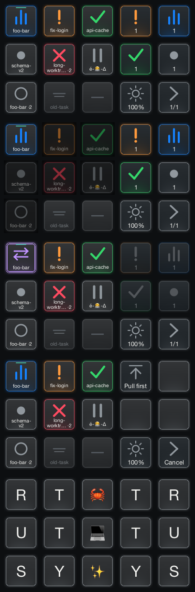

# Rustty agent dashboard for Stream Deck

Rustty owns one USB device and one tile per **reporting live Rustty pane**, across
all windows and tabs. Completed OSC 133 shell commands also qualify for a tile under
the command notification policy. The companion Codex TUI emits private pane-local OSC status;
normal launching and shared daemon use are unchanged. Hidden subagents have no
separate tiles. Two panes in the same directory remain distinct. Switching the
thread displayed by a TUI updates its existing tile.

The dashboard needs no daemon: Rustty holds pane status, layout and device state.
Codex may use its own existing shared app-server or its embedded app-server;
neither changes Rustty's ownership. The emitter runs inside the Codex TUI.

## Enable without installing anything

Build the two checkouts; do not replace installed applications:

```sh
# Rustty checkout
cargo build -p rustty-app --bin rustty
# Codex checkout
cd /Users/byron/dev/github.com/openai/codex/codex-rs
CARGO_TARGET_DIR=/tmp/codex-rustty-build cargo build -p codex-cli --bin codex
```

Launch the Rustty checkout binary with `--stream-deck=true`. For a lasting opt-in,
add this to **Rustty's** settings (the integration defaults off):

```text
stream-deck = true
# Only needed when more than one device is connected:
# stream-deck-serial = YOUR_SERIAL
```

Enable this only in the Rustty instance controlling the USB device. A local or
remote tmuxx host, including Windows, collects and retains pane status without
`stream-deck = true`.

Within its panes, launch the companion Codex binary normally with a per-invocation
override; this does not edit global Codex settings:

```sh
/tmp/codex-rustty-build/debug/codex \
  -c 'tui.terminal_status="rustty"'
```

Alternatively enable `terminal_status = "rustty"` under `[tui]` in a configuration
you explicitly choose to edit. No `TERM_PROGRAM` detection, launcher, registry,
plugin hook, daemon, session-to-pane mapping, or per-key profile is required.

Only one controller should own the selected device. Stop the standalone
`stream-deck-ctrl` prototype deliberately if it is running; do not terminate
unrelated controllers. Reloading Rustty settings enables/disables discovery and
connection ownership. Unplugging or USB errors leave terminals running.

For a disposable reporter, run `rustty agent-sim` inside a Rustty pane. It cycles
all seven states every three seconds; `--state working` holds one state and
`--interval 0.5` changes the reporting cadence. Ctrl-C unregisters it.
See [protocol, simulator and demo](../rustty-agent-status.md).
For the icon meanings and controls, print a separate reference in any terminal:

```sh
target/debug/rustty stream-deck-legend
```

The legend does not open the device or start a desktop window. Agent and function
keys use large icons instead of state/function words. Function keys retain their
small counts, brightness percentage and page indicator. An agent's remaining
space holds a short task slug with margins; long names wrap and shorten by
grapheme rather than shrinking the font.

A small arrow in the upper-right marks reports from tmux-backed panes, including
local tmuxx sessions and SSH connections. It uses the empty corner without moving
or resizing the status icon, focus stripe, or task label.

Names come from the pane's directory, independently of pane/tab titles, reporter
prose or opaque thread IDs. A terminal title that exactly names a directory in
the pane's path can identify the worktree above a nested working directory;
otherwise the current directory name is used. The `project.task` naming convention
strips the first prefix: `gitoxide.foo-bar` becomes `foo-bar`, and
`gitoxide.foo.bar` becomes `foo.bar`. Names without a dot stay whole. Leading-dot
names are retained. This is name formatting, not a Git
worktree scan; a plain dotted directory follows the same convention.

The source and test previews use actual 72×72 key images, showing the normal
board, dim flashing phase, move mode, alternate controls, and no-session board:



## Fixed 5×3 layout

| Agent | Agent | Agent | Function | Function |
|---|---|---|---|---|
| 1 | 2 | 3 | ! count | ▂█▅ count |
| 4 | 5 | 6 | ✓ count | ● count |
| 7 | 8 | 9 | ☀ level | › current/total |

The left 3×3 region holds nine logical slots per page. Physical indexes come from
the driver's layout metadata (agents 0,1,2,5,6,7,10,11,12; functions 3,4,8,9,13,14).
Only display devices with exactly five columns, three rows and fifteen keys are
accepted in this version. Mini, XL, Neo, Plus and Pedal layouts are rejected
clearly; there is no claim that every model has a 3×3 agent area.

A short agent-key tap reveals and focuses its exact pane. Hold for **two seconds**
to enter move mode; release does not focus or cancel. The next fresh agent-key
press swaps assignments, including empty slots and inactive reservations. Press
the same logical source slot to cancel. The destination may be pressed while the
source is still held; already-held keys are not fresh destinations. Releases are
consumed. The source slug remains visible with purple ⇄ swap arrows and outline.

During move mode **Page and Brightness still work**. The four state-cycle keys
are dimmed and disabled. Function keys cannot be moved. A Page tap advances/wraps
on release and has no effect when there is one page. Status, label and focus
changes never sort or compact slots. Interior holes stay holes.

Outside move mode, hold **Page for one second** to replace the four state-cycle
keys with a one-shot menu. Releasing Page keeps it open. The top-left function
key becomes **Pull first**; the other three are blank and inert. Select Pull first
to run it and close the menu, or tap Page again to cancel. Brightness still works.
Only fresh presses count; held keys and stale artwork cannot select an alternative.
Sleep, disconnect and layout changes cancel the menu.

Attention, Working, Done and Idle cycle live agent, command and OSC progress panes in stable slot order,
including off-page and hidden panes. They advance from the focused matching pane,
otherwise from the group's last slot cursor, and wrap. Membership is recomputed
each time; an empty group is dimmed and inert. The selected agent pane's page is revealed.
Attention includes needs-input, error and paused states. Unknown remains directly
tappable and pageable. Progress-only panes follow assigned panes in workspace order
without occupying agent slots. Each pane counts in one group: structured agent
status takes precedence over progress, and OSC 133 command status is the fallback.
These actions never approve a request, submit a prompt or send agent keystrokes.

Brightness starts at 100%; successive taps select **25 → 50 → 75 → 100 → 25%**.
The worker changes the displayed level only after a successful USB write. The
selected level lives in memory and is reapplied on reconnect; it is not read back
from the device or saved to disk. Holding a function key does not repeat it.

## Menu, shortcuts and Pull to First

Rustty shows a native **Stream Deck** menu after successfully opening and
initializing the device, and removes it on disconnect or disable. It offers the
four state cycles, Next Page, Brightness and Pull to First. All seven commands
support configurable shortcuts; none has a default binding. For example:

```text
keybind = ctrl+alt+p=stream_deck:pull_to_first
```

The `stream_deck` arguments are `needs_input` (Attention), `working`, `done`, `idle`,
`next_page`, `brightness` and `pull_to_first`. Shortcuts require the connected
device. Rapid brightness presses preserve every cycle step while coalescing
pending USB writes to the final level.

Pull to First returns to page one and chooses up to nine live, non-idle agents,
prioritizing **Needs input → Done → Working → Paused → Error/Unknown**, then the
most recent activity within each category. Activity means a state, thread or
turn change; duplicate reports, labels and focus do not make an agent newer.
Chosen agents already on page one keep their positions. Incoming agents swap
into empty slots first, then inactive reservations, then idle agents, then the
oldest remaining agents. Within each destination group, older activity goes
first. This prioritizes incoming agents without rearranging familiar positions.
Idle agents are never promoted, and displaced assignments remain on later pages.

## Status and completion semantics

OSC 133 shell commands acquire a tile only after completion, following
`notify-on-command-finish-after` and `notify-on-command-finish`: `never` disables
command tiles, `unfocused` admits results when the pane is unfocused at completion,
and `always` admits them regardless of focus. Running shell commands never acquire
generic Working tiles: OSC 133 cannot distinguish a task from an interactive SSH
session. Explicit progress and agent status still report running work.

`notify-on-command-finish-exclude` suppresses generic completion tiles and alerts
for named executables. The defaults are `ssh`, `mosh`, `tmux`, `tmuxx`, `screen`,
and `tix`. Repeat the setting to add names; an empty value clears the list,
including the defaults:

```ini
# Add to the defaults.
notify-on-command-finish-exclude = nvim
notify-on-command-finish-exclude = my-ssh-wrapper

# Or replace the defaults with your own list.
notify-on-command-finish-exclude =
notify-on-command-finish-exclude = ssh
notify-on-command-finish-exclude = tix
```

Exclusions are checked when the command starts. Rustty uses OSC 133's optional
`cmdline_url` field, otherwise the input text between the shell's input and output
markers. Plain OSC 133 C alone carries no command name. Missing or discarded input
stays unknown and does not match an exclusion; window titles are not used.
The first literal executable name is matched, ignoring its directory and a Windows
`.exe` suffix. Leading environment assignments and flagless `command`, `exec`,
`builtin`, and `env` prefixes are skipped. Aliases, shell expansions, and other
wrappers are not resolved: add the wrapper or alias name to the list. Explicit
progress, notifications, and agent status still work for excluded commands.

At command completion, the current policy and duration threshold determine
whether its result appears: exit 0 is Done, nonzero is Error, and missing exit
status is Needs input. Revealing/focusing a finished command clears its tile;
starting another command, resetting the terminal or closing the pane also clears
it. OSC 133 is only a fallback: once a command emits structured agent status,
OSC 9;4 progress, or a terminal notification, its generic tile and completion
actions are suppressed for the rest of that invocation. Progress clear, expiry,
reporter shutdown and focus acknowledgement do not release that suppression.
Structured agent status also supersedes progress from the same invocation,
preventing a second aggregate entry after the agent reporter ends.
Native tmuxx does not restore command start times on attach, so commands already
running before attachment cannot qualify by elapsed duration.

Commands that use an explicit system control their own notifications; Rustty does
not add a generic “Command finished” alert, even if their terminal notification
cannot be delivered. Bell and title changes alone do not suppress the fallback.
Notifications sent directly by external OS hooks are invisible to Rustty and
cannot be deduplicated.

The following states describe explicit agent reports:

| State | Source/meaning |
|---|---|
| Idle | Attached/ready, cancellation, or locally acknowledged completion |
| Working | Current displayed thread is active without stronger request/error evidence |
| Needs input | A pending approval or input request, including nonblocking requests |
| Done | An observed completed turn available to inspect; not proof of success |
| Error | Explicit relevant thread/turn error |
| Paused | Explicit pause; not the symbol for a nonblocking question |
| Unknown | Lost/unloaded status or insufficient evidence; never inferred completion |

Codex reports both thread and turn IDs. Rustty acknowledges done locally when its
pane is revealed/focused, projecting that completion as idle without sending
anything to Codex. Duplicate completed-turn snapshots stay acknowledged across
A/T1 → B → A/T1; A/T2 is new. Each pane retains the last acknowledged completion
for up to 64 threads in its current reporting lifecycle. Evicting a thread can
make its old completion appear unread again. A new begin replaces the lifecycle.

Unseen important states flash the agent tile between normal and 55% artwork
intensity every 600 ms, retaining its icon and slug. Needs input, Done, Error,
Paused and Unknown flash on first observation or a new transition; Idle flashes
when an existing thread becomes ready/stops, including cancellation or interruption.
Initial Idle and Working remain quiet. Revealing/focusing the pane stops its flash;
states arriving while it is focused are immediately seen. This does not resolve
requests or change status, except for the existing Done-to-Idle acknowledgement.
Duplicate snapshots and label changes do not restart flashing; a new completed
turn or a later important state does. Attention history shares the 64-thread
lifecycle bound with completion acknowledgements, so eviction can make an old
state appear unseen again. Device reconnect and screen sleep preserve this state;
sleep suppresses rendering and focus acknowledgement. Only agent tiles on the
current page flash; Page and state counts remain fixed. Move-source artwork stays
steady until the move ends. Flashing never changes key targets or tile positions.
The v1 protocol has no request identity: same-state updates cannot distinguish a
new approval from a duplicate. A new observed state transition is needed to rearm.

Existing Rustty title/progress presentation remains available; it cannot override
an explicit structured status or allocate a tile by itself. Progress expiry, redraw,
RIS and compaction are not exits. Normal end, pane/PTY exit, or a trustworthy
foreground-command end clears registration. A crash with no observable cleanup
boundary can leave uncertain state. There is no heartbeat or silence-to-done rule.

OSC 9;4 progress additionally contributes to the aggregate controls: determinate
and indeterminate progress join Working; error and paused progress join Attention.
100% is still Working. The 15-second progress timeout drops the stale entry from
the aggregate controls without marking it Attention or Done; fresh progress resumes
tracking. An explicit clear finishes with Attention unless a result is known.
For still-tracked progress with no explicit result, shell completion can resolve
that existing entry: exit 0 joins Done; nonzero or missing exit status joins
Attention. It never restores an expired or acknowledged entry. Leading ✅
notifications mark success; leading ❌, ⚠, or ✅⚠ mark Attention, catering to
`wait-pr` and `notify-me`. Explicit results take precedence over shell exit status:
`wait-pr`'s merged notification remains Done even if subsequent cleanup fails,
and its “CI finished, but not merged” warning remains Attention despite exit 0.
Heartbeats retain result evidence across timeouts, and duplicate results do not
rearm acknowledged entries. An explicit final result also takes precedence over
an earlier progress error, allowing a reported recovery to finish successfully.
Other notification prose is not interpreted as a result. A timeout alone never
proves success. Terminal reset discards progress; disabling visual progress bars
does not disable aggregate tracking. Finished progress remains until the pane is
revealed/focused or a new foreground command/progress cycle begins. Active errors
and pauses remain selectable until progress changes, finishes, or times out.
These runtime signals are not persisted and do not change the pane's structured
agent status.

Native tmuxx views all observe terminal notifications for status and fallback
suppression. Only the elected recipient delivers the desktop notification;
delivery does not reapply status or attribute a delayed alert to a later command.

## Empty board and persistence

With no live agent or qualifying command tiles and no pending OSC progress the entire board becomes:

| | | | | |
|---|---|---|---|---|
| R | T | 🦀 | T | R |
| U | T | 💻 | T | U |
| S | Y | ✨ | Y | S |

These keys are decorative and inert while the Mac's displays are awake. Idle/done
sessions still count. Transitions cancel gestures and suppress keys held across
the change. The USB owner stays
connected and preserves the selected brightness. The next begin restores the
normal board and existing positions. Progress alone also enables the aggregate controls.

Workspace `deck_positions` stores a bounded vector of optional pane IDs. Status,
thread/turn IDs, USB handles and gestures are never persisted. Ending a reporter
reserves its live pane's slot quietly; closing the pane leaves a hole. New reporters
take the first free hole, otherwise reclaim the first inactive reservation in slot
order, and only then extend the board. Registered reporters keep their positions
in every state, including Idle and Done. Reclaiming a reservation does not close
its pane; if it reports again, it receives an available slot using the same rules.
Assignments and eviction wait until any hold/swap gesture ends. Imports keep
current positions and imported panes receive positions on first report.
Terminal undo/redo preserves the current dashboard arrangement; swaps do not add
terminal-layout history. Invalid auxiliary references are normalized without
losing the terminal workspace. `window-save-state=never` makes arrangements
session-only. Older Rustty versions may drop the optional field when saving.

On macOS, screen sleep (and impending system sleep) dims the Deck to 15% without
clearing artwork, registrations or positions. The board keeps updating, with
flashing paused. Brightness and next-page controls still work without waking the
Mac; brightness changes while dimmed are temporary. On wake, Rustty restores the
percentage selected before sleep and refreshes the board. Connecting while the
screens are asleep also starts at 15%.

Any other key wakes the Mac's displays without activating its usual action;
release it and press again to activate. This also works on the decorative board.
Rustty uses macOS's user-activity power API, without synthetic input or accessibility
permission. A wake press on the dimmed Deck checks display state once: if the
Mac is already awake, Rustty restores the Deck immediately; otherwise it requests
display wake. There are no periodic display-state checks or checks on normal
awake button actions. Locking alone leaves the board intact; waking displays
does not unlock the Mac. Pending gestures are
cancelled and keys held across sleep/wake cannot trigger actions. Done is not
acknowledged while screens sleep.

Full system sleep or USB power loss still depends on hardware to wake the Mac;
Rustty cannot handle button input while suspended. The pre-system-sleep dimming
write is best effort if macOS suspends the process or USB first; wake/reconnect
restores from Rustty's retained state. Windows keeps its current behavior;
screen-power integration is macOS-only in this version.

## Ownership and limitations

Discovery is a short off-UI enumeration at most once a second while enabled and
absent. There is no resident absent-device USB/rendering worker. A suitable
candidate starts a single connection-scoped owner of HID, fonts, images and reads.
On macOS, a scoped exclusive guard releases hidapi 2.6.7's process-global HID
manager before its owning thread exits. Its C backend otherwise retains a dead
discovery-thread run loop, which caused an observed crash during worker startup.
The guard covers all HID use in this application; the pinned backend's public
`hid_exit` cleanup runs after device handles are dropped. No unsafe Send/Sync or
resident discovery thread is used.

A single pending semantic snapshot coalesces updates; a bounded action queue
wakes the UI. Reconnect waits for the previous worker to finish. Input is polled
with 20 ms finite reads between individual changed-tile uploads; the hold timer
advances without incoming HID events. No external accessibility daemon is used.

| Category | Boundary |
|---|---|
| Driver/device | Pinned `elgato-streamdeck` c8b9f854 (0.13.2); no image, profile, brightness or pane-map readback. Previous artwork/settings cannot be restored. Only USB display devices with the accepted 5×3 layout; backend HID writes have no driver-level timeout. |
| Codex producer | Full automatic reports require the companion TUI option. Stock notification/hook configuration does not provide registration, working start and request resolution. |
| Scope | One tile per reporting agent or qualifying shell-command pane and one device. No hidden-subagent/outside-Rustty tiles, approval, command execution, usage, dial/touch/LCD or desktop Micro actions. |
| Semantics | Done observes a turn completion, not task success. Any process sharing a PTY can spoof that pane's metadata. Unobserved crash cleanup remains uncertain. |
| Multiplexers | Native tmuxx keeps each pane's reporter separate and accepts raw or tmux-wrapped status. Multiple stock tmux reporters sharing one outer Rustty PTY exceed the serialized single-reporter contract. |
| Layout | Exact 9+6 region targets 5×3 devices; other layouts are rejected. Input/error/paused shapes are distinct; Attention groups these states. Brightness is memory-only. |
| Persistence | Workspace save policy applies, IDs only reserve positions, and restored panes require a new begin report. Bounded completion-ack history is runtime-only. |
| Input race | UI validates captured assignments and reporter generations. USB reports cannot identify which image generation was physically seen; a bounded upload/input race remains. Startup held-key baselines suppress stale presses. |
| Verification | Offscreen/unit tests do not certify firmware, physical readability, button timing, OS focus, SSH/tmux/ConPTY or installed binaries. See the validation record below. |

The renderer adapts the dark inset face, colored rim/glow and shapes of
[dazer1234/codex-stream-deck at 6d7d14b9](https://github.com/dazer1234/codex-stream-deck/tree/6d7d14b9c966de305617a43a7ac22c7034ac075e).
Its MIT notice is retained in [the reference license](stream-deck-reference-LICENSE.txt).
Text uses Rustty system shaping/fallback, with grapheme-aware bounds and correct
premultiplied sRGB color-glyph compositing. Missing glyph coverage still depends
on installed system fonts.

## Reproduce validation

```sh
cargo test --workspace --all-features
cargo clippy --workspace --all-targets --all-features -- -D warnings
cargo fmt --check
cargo check -p rustty-app --all-targets --target aarch64-pc-windows-msvc
RUSTTY_DECK_PREVIEW=/tmp/rustty-deck.png \
  cargo test -p rustty-app --lib deck_device::tests::contact_sheet -- --ignored
RUSTTY_SMOKE_DIR=/tmp/rustty-deck-native-check RUSTTY_SMOKE_OFFSCREEN=1 \
  RUSTTY_SMOKE_DECK=1 target/debug/rustty --config-file=/tmp/empty-rustty.conf
```

Use `RUSTTY_SMOKE_DECK=only` to run just the native dashboard checks, including
menu/shortcut chains and stale control rejection, without the general terminal
rendering and shell-input stages.

The native smoke fixture forces USB off and uses test-owned shells/workspace.
The explicitly ignored `hardware_usb_smoke` test opens the physical device and
replaces its images/brightness; run only after deliberately transferring ownership.

## Validation record (2026-10-08)

Implementation started from clean Rustty `rustty` at `b24fbb556` (newer than the
research checkout), clean Codex `my-queue` at `1f0b5a95`, and clean prototype
`de2625de`. No Ghostty production source, installed application or global Codex
configuration was changed.

- macOS arm64: full Rustty workspace/all-features run passed **598 tests**, with
  5 explicitly ignored tests; strict workspace/all-targets/all-features Clippy
  and formatting passed. Protocol, lifecycle, layout, gesture, renderer and fake
  device behavior are covered.
- The built-in `agent-sim` passed real macOS PTY checks for terminal-output
  enforcement, fixed/cycling status, signal cadence, prompt Ctrl-C cleanup even
  with a 60-second interval, and ordered end/begin through suspend/resume.
  Windows compilation passed; its console-control runtime remains untested.
- Windows ARM64: `cargo check -p rustty-app --all-targets --target
  aarch64-pc-windows-msvc` passed. This is compilation evidence, not Windows
  execution, ConPTY or physical USB certification.
- Companion Codex: the 12 tests matching `terminal_status`, three existing OSC9
  tests, eight daemon-startup tests and the config opt-in test passed, along with
  formatting and strict `codex-tui --lib --tests --no-deps` Clippy.
  Dependency-inclusive Clippy stops on
  an unchanged `clippy::let_and_return` in `app-server/src/message_processor.rs:372`.
  The committed source matches the isolated tested checkout. See the companion's
  `docs/rustty-agent-status.md` for the commands and transition evidence.
- Actual Codex CLI processes passed a disposable macOS PTY check: two ordinary
  TUIs in the same directory used one existing isolated local daemon and emitted
  distinct thread IDs to their own stdout. `/clear` retained one reporting
  lifecycle. A loopback fake response provider exercised working/completion with
  real turn IDs, cancellation, optional input resolution and approval denial;
  OSC9 notifications remained intact. Both `/quit` paths emitted one end, and an
  opt-out TUI emitted no private OSC. Both temporary-config opt-in and the
  documented `-c 'tui.terminal_status="rustty"'` form passed. The latter initially
  exposed a missing daemon-compatible override entry; the companion now preserves
  Codex's existing server selection. The fixtures used no credentials or external
  model requests and reaped only their own processes.
- Isolated native Rustty smoke passed: windows/tabs, minimized reveal, quick
  terminal show path, completion acknowledgement, pending-input preservation,
  pane removal, and save-state-never. It injected semantic reports and kept USB
  disabled. The existing native/renderer checks also passed with Metal access.
- The actual **MK.2 Scissor, firmware 1.00.005**, passed the opt-in USB smoke:
  normal/decorative 72×72 uploads, 100/25/50/75/100 brightness writes, finite input
  read and owned-handle reset. This by itself does not establish physical
  readability, press timing or pane-focus behavior.
- The physical-size contact sheet was rendered and visually inspected against
  the pinned dark reference. No OS-specific font golden is required.

Authenticated model services, external approval auto-resolution, live resume/fork
picker flows, SSH/tmux, Windows ConPTY, other devices/firmware and installed-binary
behavior require their own checks. Unit tests cover auto-resolution and cached
thread switching; the runtime fixture above uses a fake local model provider.

For an interactive **simulated** hardware fixture with twelve real PTYs across
two windows/four tabs, use a fresh disposable directory:

```sh
mkdir -p /tmp/rustty-deck-interactive-check
RUSTTY_SMOKE_DIR=/tmp/rustty-deck-interactive-check \
  RUSTTY_SMOKE_INTERACTIVE_DECK=1 target/debug/rustty --config-file=/tmp/empty-rustty.conf
```

It never starts Codex. Labels say Demo, and each terminal says SIMULATED. Creating
`/tmp/rustty-deck-interactive-check/.deck-ended` ends all reports while keeping
panes/reservations; deleting that marker begins them again. The fixture remains
running for manual checks and saves only its temporary workspace. Close its two
test windows to finish. Use a new directory for each independent run.

User-confirmed physical MK.2 checks with the isolated simulated reporters:
upright/readable labels, exact-pane tap focus, two-second hold and swap including
cross-page movement, brightness sequence without held-key repeats, all four state
cycle keys, and the exact inert 15-key decorative board. The same saved slot
vector remained intact through end/begin restoration. No real Codex conversation
was used in this physical test.

The initial interactive run exposed a macOS hidapi thread-lifetime crash not
covered by the same-thread USB smoke. The scoped manager cleanup above fixed it;
three subsequent real-device discovery/open/read/close cycles on fresh threads
and the interactive controller passed. Re-audit the guard when changing hidapi,
using shared-device mode or adding another process-local HID client. A persistent
HID owner thread is an allowed fallback if a future backend requires it.

The user also physically unplugged/replugged the MK.2 and confirmed automatic
board restoration with the selected **25% brightness**. The isolated Rustty
controller was left running afterward and later closed by the user.

The later icon-first artwork update was checked using the physical-size contact
sheet, label/layout tests, captured legend CLI output and Windows compilation. Earlier physical checks cover
the controls and device lifecycle; the revised artwork has not yet been checked
on the MK.2 itself. `stream-deck-legend` prints the meanings independently of USB.

## Display sleep validation (2026-10-12)

The 28 deck-related library tests and two host tests pass, including startup while
asleep, temporary brightness changes and restoration, failed brightness writes,
held-key suppression, decorative-board wake, power transitions arriving during
USB reads, and a fresh second press before wake artwork has finished uploading.
Formatting and the signed release app build pass. Strict Clippy stops on existing
warnings in `rustty-parser`, `desktop.rs` and `smoke.rs`; the changed files add no
diagnostics. This update has not been tested through a physical overnight power
loss or full-system-sleep cycle, and the existing controller was not interrupted.
