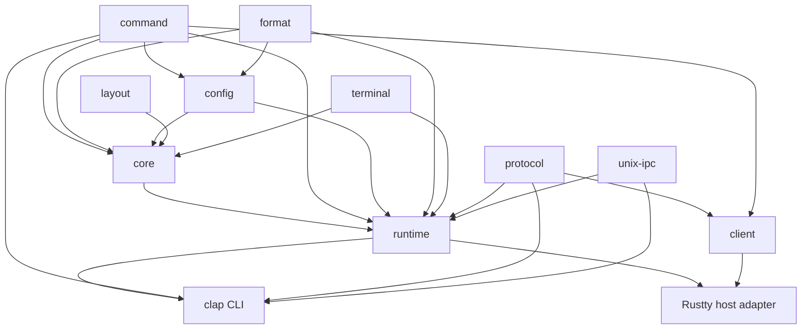
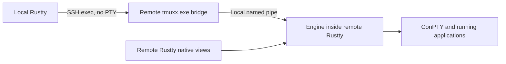

# tmuxx: imported architecture and conformance plan

This document records the imported implementation and its historical validation.
See [README.md](README.md) for current workspace ownership and maintenance.
References below to sibling checkouts and prior platform authorization describe
the source repository; they do not authorize actions or qualify this import.

Architecture and implementation contract, revised 2026-10-20. The Rust workspace
implements the Unix engine, runtime, native client and C command/control
transports. All six scoped macOS profiles passed the
[conformance runner](conformance/README.md): 149 executable suites and 430 scoped
assertions. Native Windows hosting is implemented and undergoing fresh
qualification; historical macOS results do not qualify Windows.

The inspected references are tmux `22f34d3fa984e03719b0a1b2ac4677aaf61cd53d`
(`next-3.9`) and Rustty/Ghostty
`cb67824a77fc00bd20e811cce40012893f79b999` in the neighboring
`ghostty-org/ghostty` checkout. C interoperability and differential tests run
against this tmux baseline and installed tmux 3.7c as separate executables;
the exact named assertions determine coverage. Linux server execution is active;
its GNU target, reference builds and independent evidence are documented in
[the imported conformance guide](conformance/README.md). Windows execution is authorized on the available Windows
Server 2025 x64/MSVC host; implementation and executable qualification continue.
Historical results do not qualify another platform; desktop obligations still
require a supported macOS/Windows client host. Deferred platforms retain their requirements
and are never counted as passing. This contract includes the requested
app-owned server, smaller crates, and narrower compatibility scope.

## 1. Product contract

Build a Rust implementation of the tmux functionality needed to integrate
native Rustty windows and to let external programs control them. Support:

1. **App-owned server:** Rustty hosts its own tmuxx server. Local and remote
   clients see and operate on the same sessions, tabs, panes, and processes.
   Its lifetime is the Rustty process's lifetime, including on Windows.
2. **Standalone tmuxx daemon:** the same engine runs without Rustty. Rustty and
   command/control clients can attach, disconnect, and reconnect. This mode
   supports sessions that survive Rustty application restarts.
3. **System tmux:** Rustty connects to an existing tmux daemon, particularly on
   Linux, through its normal control interface. No remote Rust installation is
   required for this case.
4. **External command/control:** the clap-backed `tmuxx` CLI controls either
   tmuxx hosting mode. On Unix, a tmux-compatible IPC adapter additionally lets
   unmodified system tmux command and control clients operate on tmuxx.

The target is command/control and Rustty integration conformance, **not a full
replacement for tmux's ordinary terminal user interface**. An ANSI terminal
renderer, status/border redraw engine, terminal chooser UI, and ordinary
interactive tty attachment are outside this plan. Supported commands with UI
consequences still need defined native behavior or an explicit unsupported
result; removing the renderer does not justify silently ignoring them.

Compatibility means tmux protocols and declared behavior. There is **no C tmux
ABI, FFI, linking, bindgen, or embedded C implementation**. Implement wire
codecs and the engine in Rust. The reference tmux executable and any test-only
oracle run in separate processes. OS/PTY APIs accessed through Rust bindings,
including Win32/ConPTY, are platform integration rather than C tmux interop.

Safer implementations may deliberately differ from tmux internals and behavior.
Keep wire contracts intact, document observable differences, and test the
intended result. Conformance is not a requirement to reproduce undefined
behavior, allocation layout, race conditions, or libevent scheduling.

The CLI accepts the scoped tmux startup flags, standard socket discovery and
byte-preserving command arguments. Clap provides `-h`/`--help` and package
identity through `-V`. Login/shell replacement (`-l`/`-c`) and tmux log-file
reproduction (`-v`) reject explicitly before starting a server. Command-level
usage and diagnostics use the generated C command registry. Both native and Unix
IPC endpoints require the same OS user; `server-access -l` lists that owner and
access changes reject without altering permissions or existing clients.

`show-messages` exposes native command/error logs and live job summaries with
Rust job IDs and kinds. Its timestamps and diagnostic text describe this
implementation; `-T` remains empty because native/control clients own no
physical tty terminfo instances. `message-limit` controls retention up to
16,384 records, each with a 4,096-byte escaped payload limit and explicit
truncation marker. C/R tests cover the shared behavior and these documented
diagnostic differences separately.

POSIX glob and regex operations use a thread-scoped UTF-8 locale with tmux's
locale preference; time formatting uses the inherited time locale. Calls restore
the embedding thread's locale, so independent hosts never change GUI-global
locale state. Unicode characters, POSIX classes and case folding have exact
C-backed format and pane-search tests.

## 2. Crates and dependency boundaries

Split by independent responsibilities and dependency costs, with `tmuxx-core`
becoming the execution/state layer rather than a catch-all package.

| Crate | Responsibility | Dependencies and exclusions |
|---|---|---|
| `tmuxx-command` | Byte-preserving argv/text parsing, lexical rules, command AST, quoting, source diagnostics | Small parsing dependencies; no engine, filesystem, runtime, or clap |
| `tmuxx-format` | Format-expression parser and evaluation over supplied context; explicit requests for deferred jobs | Independent of core; regex support only for required operators; no process spawning |
| `tmuxx-config` | Config parsing/preparation, directives/conditionals, includes/source requests, diagnostics | Reuses `tmuxx-command` and `tmuxx-format`; supplied evaluation context, no second command interpreter or implicit filesystem access |
| `tmuxx-layout` | Layout representations, parse/serialize, integer cell geometry, split/resize/zoom operations | Pure algorithms; serialization dependencies only where needed for supported layout formats |
| `tmuxx-terminal` | Headless application-output parser, screens/history, terminal modes, replies, snapshots/damage, graphics state | Terminal/Unicode/graphics dependencies; no GPU, GUI, SSH, or process owner |
| `tmuxx-core` | Sessions/windows/panes, synchronous command effects, targets, options/environment, format-job state and buffers | The five preceding crates; no sockets, PTYs, platform event loop, or clap |
| `tmuxx-protocol` | Standard control-mode byte codec and separate versioned native messages/snapshot DTOs | No engine; native serialization behind its own feature; no OS I/O |
| `tmuxx-client` | Request tracking, discovery, capabilities, pane model, bootstrap/reconciliation and flow control | Command and protocol only; no layout, core, runtime or Unix IPC dependency |
| `tmuxx-unix-ipc` | tmux's Unix command/control wire schema and descriptor transport, shared by CLI/runtime adapters | Unix-only Rust OS bindings; no core or terminal renderer; explicit schema/version support |
| `tmuxx-runtime` | Host the core, schedule per-client command queues/hooks/jobs, perform effects, own processes/PTYs, timers, endpoints and shutdown | Core/command/config/format/terminal/protocol; native protocol enabled; Unix IPC on Unix; named pipes and bundled ConPTY on Windows; no GUI or clap |
| `tmuxx-cli` | The `tmuxx` executable: clap startup flags, commands, stdio control bridge, standalone server startup | Runtime/command/protocol and Unix IPC on Unix; native protocol enabled; no client dependency or duplicate command execution logic |

Configuration preparation and command execution are separate phases. Tmux
evaluates `%if`, environment expansion, and assignments while parsing a source,
before its commands are queued. Preserve that timing using supplied context,
explicit preparation-time environment updates and source/evaluation requests;
runtime performs required I/O and schedules the prepared commands against core.
Do not make a queued `set-option` or `set-environment` retroactively affect
preparation of the same source. Test assignment versus command behavior,
`set-option` followed by `%if`, and nested `source-file` ordering. Any deliberate
change to this timing needs its own difference entry. Format semantics stay in
the format crate, including preparation rules such as disabling format jobs in
`%if` conditions. Argv and command strings remain distinct parser entry points.

Keep AST types with parsers, terminal state with the terminal crate, engine
objects with core, and wire DTOs with protocol. Adapt explicitly at boundaries;
a universal shared-types crate would couple unrelated layers. Core uses the
layout crate; the client consumes protocol metadata without a layout dependency.
Protocol DTOs do not expose engine objects.

Unix/Windows host implementations initially remain modules in runtime. The
Unix IPC crate is separate because it has a distinct wire contract, OS-only
dependencies, and consumers in the CLI transport and runtime server. Split
further only when another concrete dependency or release boundary warrants it.

The dependency direction is acyclic:



Arrows mean dependency provider to consumer. Client-only library consumers do
not compile the engine or Unix IPC. Native serialization is a protocol-crate
feature enabled by runtime and CLI; neither offers a separate native feature
switch. Runtime and CLI include Unix IPC on Unix targets. Rustty owns the GUI
adapters; tmuxx crates remain usable standalone.

The additive workspace is organized as follows:

```text
rust/
  Cargo.toml
  Cargo.lock
  ARCHITECTURE.md
  crates/tmuxx-{command,format,config,layout,terminal,core}/
  crates/tmuxx-{protocol,client,unix-ipc,runtime,cli}/
  conformance/
    manifest.toml       # profiles, source map, capabilities, required assertions
    differences.toml    # tested intentional differences
    scope.json          # reviewed upstream responsibilities and source hashes
    *-evidence.toml      # exact executable tests for named assertions
    runner.py           # separate-process comparisons and profile gates
    generate_*_metadata.py
  integration/rustty/    # pinned Rustty integration patch and source manifest
  vendor/               # standalone terminal/parser dependencies
```

These crate boundaries are implemented. The conformance runner determines which
named behavior assertions have executable evidence; crate presence alone does
not qualify a profile.

## 3. Hosting and process lifetime

| Mode | Engine and PTY owner | Rustty owner exits | A remote viewer disconnects |
|---|---|---|---|
| App-owned | Engine/runtime hosted by the Rustty process | Server and its app-owned panes stop | That view detaches; local and other remote views continue |
| Standalone tmuxx | Independent daemon | GUI detaches; retained panes continue | View detaches; daemon continues |
| System tmux | Existing tmux daemon | GUI detaches | Normal tmux detach behavior |

App-owned is a first-class production mode, not just an ephemeral test mode.
Rustty embeds the engine and runs its owner loop off the GUI thread. Local typed
requests and remote command/control requests enter that same loop. The lifetime
is the application **process**, not necessarily its last visible native window;
Rustty's close-last-window policy determines when the process exits.

For the earlier on-demand persistence use case, create the workspace under the
standalone daemon from the beginning. Persisting a daemon-managed pane changes
retention policy after an acknowledgement. It pins the pane and the graph links
needed to reach it; ephemeral cleanup respects other owners and shared windows.
Do not silently promote sibling panes to persistent.

An already-running app-owned pane cannot survive death of its owner merely by
changing a flag. PTY/ConPTY and complete engine-state transfer would be a separate
migration feature. Choose the owner when launching the pane; restarting an
app-owned workspace can restore configuration, but does not resurrect its jobs.
Existing unmanaged Rustty panes are not remotely attachable until they are
created under the engine. This avoids an implicit process-migration requirement.

Standalone runtime drains PTYs and answers application queries with no views
attached. It retains the owning server across GUI upgrades; negotiate with a
running older server instead of killing jobs to replace the binary. Daemon death,
OS logout policy, and host reboot are separate from GUI-restart persistence.

The runtime must create children safely from a multithreaded host using proven
platform spawn/PTY mechanisms. It must not fork the GUI and continue arbitrary
Rust execution in the child to turn itself into a daemon. Test cleanup of child
processes and descendants, including abrupt owner exit, with platform-specific
semantics rather than assuming POSIX signals on Windows.

On macOS, a minimal helper watches an owner-lifetime socket and kills registered
PTY sessions when the owner dies without running cleanup. Registration is
acknowledged before a successful spawn becomes visible. It covers foreground and
background process groups even after their session leader exits; processes that
deliberately create a different OS session are outside this ownership boundary.
The helper closes inherited descriptors and uses preallocated storage for at most
16,384 owned sessions and 131,072 process IDs. A crash between spawning a child
and registering it can escape this cleanup; atomic ownership during spawn needs
a pre-exec spawn broker.

On Linux, a spawn broker monitors the owner's process pidfd and ownership channel
and is the parent of every PTY leader. A forked worker retaining a copy of the
channel cannot extend the original owner's lifetime.
The broker records ownership before exec and acknowledges a spawn only after
exec succeeds, closing the spawn/registration crash gap. Exit observation uses
`waitid(WNOWAIT)`; an exited leader remains reserved until the last pane/reaper
lease is released, preventing its session number from being recycled. Cleanup
scans the registered sessions through `/proc`, stops their members, and signals
exact processes through pidfds. Foreground/background groups and reparented
descendants remain covered after leader exit; deliberately independent `setsid`
sessions retain the documented exclusion. A subreaper collects adopted zombies.
Transport failure closes the ownership channel and cleans children even when
their spawn reply was lost. Independent owners are separate brokers.

The Linux broker uses a raw fork-like syscall and only preallocated storage and
syscall wrappers before exec; it runs no inherited allocator locks or atfork
callbacks. It requires pidfd support including `waitid(P_PIDFD)` (Linux 5.4+), `TIOCGPTPEER`, and accessible
`/proc` for the same PID namespace. Missing prerequisites fail explicitly.
Limits are 16,384 owned sessions, 2 MiB of spawn strings and 65,536 strings per
spawn. These are implementation limits, not tested support for every kernel since
5.4. Bounded cleanup cannot force an uninterruptible kernel task to finish before
its pending SIGKILL takes effect. No cgroup delegation or root privilege is
required for normal hosting.

Windows creates non-inheritable kill-on-close Job Objects before spawning. Both pane
processes and shell/pipe/format jobs enter their jobs atomically through
`PROC_THREAD_ATTRIBUTE_JOB_LIST` in `CreateProcessW`. ConPTY ownership remains
after the initial process exits while background descendants run. Once the job
is empty, closing the pseudoconsole produces actual output EOF before publishing
the final pane exit. Closing an owner or pane terminates its entire owned job.
Rustty native and system SSH helpers use the same atomic ownership path with
binary stdio, separate diagnostics and no console window, including during the
initial handshake and after abrupt viewer death.

## 4. Windows app-owned server and shared views

Windows format regex/glob evaluation uses a pure Rust POSIX matcher with an
explicit [Unicode locale contract](vendor/posix-regex/WINDOWS.md), byte-exact
captures and earliest/longest match preference. Private UCRT locale handles
implement time/numeric formatting without changing the embedding GUI's locale.
Pattern and work-budget errors propagate through pane-content format expansion;
they are never successful negative matches. Unix retains its libc implementation.
Windows `b`/`d` modifiers use byte-preserving native path-prefix rules documented
in [WINDOWS-PATHS.md](crates/tmuxx-format/WINDOWS-PATHS.md).
Native algorithm tests do not establish complete C-reference format parity.

The Windows path is:



Rustty exposes a per-user, instance-identified named pipe. The remote CLI locates
and attaches to the already-running instance, then presents command or `-C`
stdio service. The bridge does not spawn a ConPTY, a second Rustty, or another
server. A missing instance yields an explicit error. Explicit standalone server
startup is a separate operation.

Rustty's `tmux` subcommand invokes the shared `tmuxx-cli` driver before GUI
registration or PTY initialization and preserves native OS arguments. Its
`--tmuxx=persistent` mode explicitly connects to or starts an independent local
owner using that driver. Startup failure kills/reaps only the child it started;
successful startup transfers lifetime to the daemon, which survives GUI exit.
Ordinary local/SSH attachments never enter this launcher. If two initial GUIs
observe an empty graph, each waits for its exact `new-session` acknowledgement;
only the exact duplicate-name response permits reuse of the winning session.
Bounded acknowledgement timeouts report an unknown outcome and never replay
the mutation. GUI startup then requires confirmation from the published graph.

Discovery records contain endpoint and server incarnation, not credentials.
Pipe ACLs and peer identity authorize access; names alone do not. Permit the
same Windows account's SSH login to reach its desktop instance across logon
sessions. Pipe names encode the account SID and the instance's UTF-8 bytes
injectively, including case and Unicode spelling. Protected DACLs grant that SID
access; server-side client-token impersonation and client-side server-process
token checks verify both peers. `PIPE_REJECT_REMOTE_CLIENTS` rejects direct
network named-pipe clients: the SSH bridge connects locally. Discovery enumerates
the live local namespace; the native hello identifies the server incarnation.
First-instance creation prevents replacing a live owner. Use private
directories/sockets and peer checks for Unix native endpoints. Multiple Rustty
instances have distinct discoverable endpoints.

Native Windows client metadata uses the pipe's actual client PID and verified
account SID/name. Client-supplied environment cannot replace those identities.
Terminal name and negotiated feature bits remain client presentation metadata;
the native protocol carries no Unix tty descriptors. The SID is exposed through
the client UID format, matching the Windows owner's UID format representation.

The native CLI applies ordered `-2`/`-T` feature changes through the same pinned
registry used by the Unix client. Its hello negotiates terminal-feature identity
before submitting commands. Unknown tokens and feature removal retain the C
parsing order. Native command errors go directly to stderr with the command's
status; transport errors retain the CLI prefix. File errors identify the exact
path, and unavailable control stdin uses the protocol's `Bad file descriptor`
diagnostic instead of interpreting POSIX errno values as Win32 error codes.

The fixed `tmuxx --native-stdio` invocation receives instance selection in the
first native hello. Without selection exactly one discovered owner is required.
An optional expected incarnation rejects replacement owners before submitting
commands. Windows OpenSSH may invoke `cmd.exe` or PowerShell; instance names are
never interpolated into either shell. Stdin/stdout remain binary-safe and stderr
separate. Named pipes use an explicit ordered input-EOF record because Windows
has no duplex-pipe half-close. The bridge never uses a PTY or terminal parser.

Rustty can explicitly override that fixed command with `tmuxx-ssh-command`, for
example a quoted path followed by `tmux --native-stdio` for its bundled driver.
This is trusted remote-shell configuration, passed as one complete SSH exec
argument with its quotes preserved. Instance selection stays in the native
hello. Reconnection and separate per-window size clients retain the same command
and private SSH configuration; neither pane commands nor instance names are
interpolated into remote-shell text.

Rustty and standalone tmuxx share the vendored `portable-pty` implementation and
one explicit process-wide ConPTY initialization contract. The pinned archive and
both runtime member hashes live in `rust/windows/conpty.json`. Runtime startup
verifies the member lengths/hashes and retains read handles denying replacement,
then loads the DLL with restricted dependency search and checks its actual module
path. Missing or incompatible resources fail before exposing an owner; there is
no in-box fallback. `rust/windows/build.ps1` packages a standalone owner with
static MSVC CRT and `resources/conpty`; `TMUXX_CONPTY_RESOURCES` explicitly selects
a different directory containing the same verified package for tests/development.

On Windows, `-D -L INSTANCE` starts the explicit foreground standalone owner.
`-L INSTANCE COMMAND` and `--native-endpoint PIPE COMMAND` only attach to an
existing owner, including for creation commands. App-owned instances use the same
runtime API. Windows has no POSIX foreground process group: automatic command
names reflect the pane's root process image, while terminal titles remain
application-controlled. Live root-process cwd is read using the retained process
handle; a dead or unreadable root yields no invented metadata or reused-PID data.

ConPTY and stdio process creation suppress Windows startup-error dialogs on the
calling thread, preserve the native launch error, and restore that thread's
prior policy. A malformed executable therefore returns an error without blocking
the owner or changing the embedding application's process-wide error policy.

### Session/window mapping

Tmux has sessions, logical windows, and panes; a tmux window is not an OS window.
Use this mapping for an app-owned instance:

- Rustty instance: one server instance with discoverable sessions.
- Native top-level window: a tmux session.
- Native tab: a tmux window linked into that session.
- Native split: a tmux pane.

An external `new-session`, `new-window`, or `split-window` changes this shared
model, and subscribed native views reconcile accordingly. The Rustty host
adapter maps session creation to a new native top-level window when that is the
configured presentation policy; this policy remains outside the headless core.
A remote-machine window can group the server's sessions, or open a native
window per session. Both arrangements represent the same remote objects.

Retain shared-window links and server IDs; do not flatten them into a fabricated
session or spawn replacement shells for a second viewer. The local console and
remote Rustty operate on the same ConPTY-backed applications. Define which
active-tab/pane commands change shared tmux state and which actions only focus
a native view. Test concurrent local and remote input, selections, and resizes.

Pane geometry is authoritative in the engine. Each view owns pixel dimensions,
viewport, graphical selection, search highlights, and presentation state. A
single sizing policy arbitrates different clients; a view must not repeatedly
resize the backend from the geometry it just received.

## 5. Engine, headless terminal, and concurrency

Start with one owner for mutable graph and terminal state. Typed local requests,
parsed commands, terminal bytes, child events, timer expirations, and worker
completions enter the owner loop. The engine emits explicit effects; runtime
performs I/O and returns completions. Time and process events can be supplied
by tests. Stable IDs and owned collections avoid shared pointer graphs.

Core keeps the session/window graph, options and environments, target resolution,
format-job state, buffers and command effects. Runtime owns per-client command
queues, hook/job scheduling, I/O completion and process lifetime. Layout and
terminal operations live in their dedicated crates. Do not port unsupported
status/redraw/chooser subsystems into core simply because their C files exist.

**Headless terminal semantics remain necessary even without a tty renderer.**
Application bytes must produce screen/history state, cursor/modes, reflow,
terminal replies, images where supported, and capture results. This is the
responsibility of `tmuxx-terminal`, not Rustty's graphical renderer.

Prefer reuse of standalone Rustty terminal primitives if they satisfy the
required observations; evaluate this with differential fixtures before copying
C's grid/parser wholesale. Isolate tmux-specific behavior and record deliberate
terminal differences. Ghostty parity by itself does not establish tmux
conformance, and tmuxx must not depend on the whole Rustty application.

Native local and tmuxx remote views consume atomic semantic snapshots and
ordered updates. Rustty currently renders/searches through mutable
`vt::Terminal` and `vt::Screen`, so implement an explicit adapter/materialization
layer. UI scrolling/search/selection must not mutate authoritative pane state
or another client's view. Test two views of the same pane.

Resizing must leave capture metadata valid for snapshot restoration. When
attaching to older owners, Rustty normalizes two legacy capture-cache defects:
used lengths wider than the retained row, and obsolete row IDs in an unknown
cache. Validate tuple shape, unsigned integers, duplicate IDs and allocation
bounds before correcting either defect; preserve allocations and reject orphan
rows in known caches. Strict terminal and graph validation still completes
before publishing any restored view. Reconnection keeps the existing pane
processes and does not replay host effects.

A view mirroring a tmux-owned terminal must not automatically send its own
DA/DSR/OSC replies back: the owning engine already answers application queries.
User input and negotiated client capability/colour reporting are separate.

Separate one-shot host effects from snapshot state. Clipboard requests, bells,
notifications, and command-completion actions have explicit recipients and
event identities. A clipboard read has one designated eligible responder;
notifications may target several views only under an explicit delivery policy.
Each Rustty enforces its existing clipboard/host-effect policy. Restoring a
snapshot must never replay host actions. Test two subscribers and reconnection
for duplicated replies, clipboard operations, or stale notifications.

Retained AgentStatus is snapshot state, distinct from one-shot host effects.
The adapter validates a complete terminal snapshot before publishing either its
terminal or agent report and observes later reports even without a native view.
Each view reconciles the latest report and its enclosing-command context through
a bounded retained slot, so a full ordinary event queue cannot permanently lose
the current status. Native presentation/acknowledgement remains view-local;
restoration does not synthesize command boundaries or host effects. Process
replacement, exit, disconnect and new server incarnations clear stale reports,
and a replacement PID re-registers a report even when its contents match.

### Allowed concurrency improvements

Parallelize independent parsing, preparation, and expensive jobs as useful,
then commit effects through defined ordering boundaries. There is no requirement
to reproduce scheduling among unrelated clients or C's readiness batches.
Preserve the promised observable contracts:

- Per-pane input/output byte order and per-client command queue order.
- Supported waits, hook placement, and command-group error/cancellation behavior.
- Matching command guards and notifications outside reply blocks.
- Observable causal ordering among output, command results, and lifecycle events.
- Consistent multi-object observations and native snapshot/update boundaries.
- Never automatically resubmit ambiguous mutations after reconnect; report an
  indeterminate result. Do not silently lose accepted input.

A semicolon-separated sequence is not automatically a transaction; neither
should its commands become independently schedulable when the supported tmux
semantics execute them without yielding. Native transactions, if introduced,
need an explicit capability rather than silently changing that baseline.

Stock control mode cannot promise exactly-once execution after a lost reply.
Native deduplication would require an explicit request-ID/retry contract; it
must not be assumed from sequence-numbered state updates.

Safer behavior on malformed input, better isolation of slow clients, coherent
native snapshots, and deterministic internal commits are valid improvements.
An intentional change to a valid command's behavior is also permitted within
the declared product profile, but must have its own expected result and an
honest description of its compatibility impact.

## 6. Three protocol surfaces

| Surface | Transport and role | Contract |
|---|---|---|
| Standard tmux control mode | Stdio, usually through SSH; system tmux or tmuxx CLI is the bridge | Standard framing/escaping/guards/events; declared command behavior, version capabilities and limits |
| Native tmuxx protocol | In-process typed API, Unix native socket, or Windows named pipe; optional explicitly negotiated SSH bridge mode | Incarnation/capabilities, commands, complete atomic snapshots and sequence-numbered updates |
| Unix tmux IPC | A separate Unix socket using tmux's imsg schema and FD passing, implemented in Rust | Supported command/control clients and schemas; no ordinary interactive tty renderer |

Keep the native endpoint distinct from tmux-compatible `-S` sockets. Never
probe a system tmux socket with native messages. Do not send unsolicited
Rust-only records into standard `-C` output. A tmuxx-aware remote bridge may
explicitly negotiate native mode for stronger synchronization; otherwise it
uses standard control mode. Windows pipes do not pretend to implement Unix
FD passing; WSL-to-Windows access needs the explicit bridge too.

### System tmux on Linux

Use the installed CLI to bridge to its daemon:

```text
local Rustty -> SSH exec -> tmux -C attach-session -> system tmux daemon
```

A dedicated SSH exec channel needs no remote PTY (`ssh -T`). Use tested quoting
for the remote Unix shell and explicit endpoint/session selection. Keep
unexpected banners and startup diagnostics out of pane data. OpenSSH owns
host-key/authentication behavior; the client library accepts supplied byte
streams and does not implement SSH itself.

Support `-CC` detection for integration entered through an existing terminal
stream as a separate path. It requires a tty and wraps control mode between
`DCS 1000p` and `ST`; it is unnecessary for the dedicated exec channel.

The client parser preserves arbitrary bytes, octal escapes, partial records,
and unknown notifications. Match closing guards by the exact
`(time, command number, flags)` triple. Numbers are server-global; one submitted
line may produce several blocks. Guard-looking command output remains output
unless it matches the active close. Do not correlate commands merely by
counting lines. Test an explicit completion barrier for high-level batches.

Source-file diagnostics use the originating client's deferred notification
queue, so they follow its closing guard. Window unlink, rename and layout events carry
the session membership and layout state from emission time: C reports an
unlink before removing the link, and can report an unzoom layout immediately
before destroying its window. Delivery must not reconstruct those events from
the already-mutated graph.

Direct control lines are prepared in the owner with the server environment and
aliases before execution. An internal parsed-command handoff preserves brace
blocks and their preparation boundary; serializing them through ordinary argv
would turn them into delayed strings. Public argv keeps its literal semantics.
Actual control clients receive a guard for every executed command, including
inserted source/block/job commands. A waiting command closes before its callback;
hook and background commands retain their separate flag state. The internal
batch-completion reply releases transport scheduling and is not another wire
guard. Deferred raw server output is surfaced as an unframed event with no
request identity, and can never satisfy a client completion barrier.

The `control-independent-session-close-order` difference permits one precise
batch boundary: independent window-close records within one destroyed session
use deterministic winlink order instead of C's red-black-tree root-removal
order. The fixture asserts both actual sequences and equal final graphs. The
batch stays after its sessions-changed record and before subsequent command or
lifecycle events; no global notification sorting is permitted.

Negotiate/probe capabilities, including flag read-back because unknown flags
may be ignored. Support legacy layouts and this branch's JSON-v2 `new-layouts`
where advertised. One control connection streams panes in its attached session;
use connections for each actively represented session and discovery for others.
Identity includes host/endpoint, server incarnation or conservative fingerprint,
and tmux IDs. `%0` alone cannot identify a pane after server restart.

Named keys and exact-byte input such as `send-keys -H` have different uses;
validate their application-observed effects, paste/mouse handling, and mode
interception. Quote commands so names or pasted text cannot become commands.
Drain transport independently of rendering and stream large responses. An
ambiguous disconnect after a mutating request is not permission to retry it.

### Native snapshots and stock tmux limits

Tmuxx can provide a complete snapshot at one engine boundary and subsequent
sequence-numbered updates. Give every server an incarnation. If a bounded
backlog is exceeded, explicitly renew the snapshot instead of silently losing
state. Coalesce presentation damage without dropping accepted input or changing
the meaning of the standard control stream. No durable event log is required.

Unmodified tmux exposes screen/history captures, selected metadata, and pending
parser bytes (`capture-pane -P`), but no general complete atomic snapshot with
replay offset. Pause/continue may discard pending output, and
`pane_output_generation` is not a byte offset. Tmuxx's stronger guarantees cannot
recover information that a system tmux server never sends.

Keep bootstrap/reconnect tests for continuous output, active SGR established
before attachment, saved cursor, partial escape sequences, both screens,
images, resize, and pane deletion. Establish and verify capture/update boundaries
for supported versions; a command batch alone does not prove atomicity. Publish
remaining system-tmux reconstruction limits as part of that client profile.
They do not prevent tmuxx from offering safer native behavior.

Standard `%output` also does not convey every tmux interaction UI. Native
selection/search is local view functionality. For supported remote copy-mode
operations, define screen/input handling and feature-gate `capture-pane -M`.
Stock tmux deliberately ignores some popup operations in control mode. Record
these capabilities honestly; an existing system tmux ordinary attachment can
remain a fallback without implementing that renderer inside tmuxx.

### Unix command/control interoperability

Include the Unix adapter to support tools that already invoke system tmux
against a chosen socket. External `list-*`, `display-message`, detached creation,
layout changes, input, and control-mode attachment should operate on the same
model displayed by Rustty. Certify exact message schemas/revisions; the inspected
reference uses protocol version 8.

Implement identification, packed argv, flags/environment/cwd, transferred FDs,
version checks, command results, file messages, and client exit lifecycle needed
by supported commands. Ordinary command output itself uses file messages, so
this is more than decoding `MSG_COMMAND`. Decode fields explicitly in Rust;
there is no C structure/ABI exposed as a library interface.

Reject unsupported ordinary terminal attachment with a clear error, including
default non-detached `new-session` or empty-argv paths that would attach a tty.
Do not signal readiness and leave a blank terminal. Detached creation and
control attachment are supported separately. The named-pipe/native CLI
lets programs control Windows Rustty; Unix imsg interoperability is
an additional Unix profile, not a prerequisite for the Windows native path.

## 7. CLI and command/configuration scope

The binary is `tmuxx`. An optional `tmux` installation alias does not imply
full ordinary-client replacement. Clap handles compatible startup options:
`-C`/`-CC`, `-f`, `-L`, `-S`, `-N`, `-D`, features, version/help and verbosity as
applicable to the declared profile. Explicitly document unsupported flags.

Preserve `OsString`/byte arguments until a defined decoding boundary. Adapt
clap defaults for help/errors/exit codes where conformance requires it. Test
empty argv, `--`, grouped/repeated flags, repeated `-f`, flags after commands,
unknown flags, non-UTF-8 Unix argv, and Windows Unicode argument handling.

Remaining argv goes to `tmuxx-command`, not clap subcommands. Config, control,
CLI commands, and native operations converge on the same core execution rules.
The remote client frames results and encodes commands; it must not depend on
core to interpret remote execution.

The scoped command inventory covers discovery, sessions/windows/panes,
layout/focus/size, input, attach/detach/control, captures/history,
options/formats/config/buffers, hooks, jobs and file commands. Include their
transitive semantics instead of stubbing dependencies of supported commands.
Modes and other UI commands follow the explicit native-effect or unsupported
policy. Native typed mutations must have the same effects as their command
counterparts. Pure view-local actions remain in Rustty.

Parse config and command grammar with precise diagnostics. Unsupported commands,
options, or UI actions return a deterministic unsupported/error result rather
than succeeding without an effect. Recognizing syntax is not a claim that every
possible tmux configuration can be executed. Track supported commands/options/
formats/config directives in one capability inventory used by docs and tests.

Use isolated endpoints during development. Preserve `$TMUX`/`$TMUX_PANE`, startup
locking, endpoint selection, environments and nested invocation for supported
Unix commands. Define Windows equivalents without inventing POSIX guarantees.
A bridge attaching to an app-owned endpoint must never auto-start an unrelated
daemon if the app disappears.

## 8. Conformance profiles and intentional differences

Replace the single full-parity claim with independently releasable profiles:

| Profile | Required evidence | Outside the claim |
|---|---|---|
| System-tmux client | Declared server-version control framing/events, discovery, input, bootstrap, flow control, SSH | Reconstructing unexported state; arbitrary future server versions |
| Tmuxx command/control | Advertised grammar, CLI/config/commands, results/errors, notifications and effects | Unadvertised commands and ordinary tty presentation |
| Rustty native views | Same underlying objects/processes, atomic snapshots, updates, input and layout reconciliation | Identical C redraw sequences or GUI appearance |
| App-owned host | Host lifetime, local/remote shared views, explicit owner shutdown; Windows ConPTY and named-pipe access | Surviving death of the owning app process |
| Standalone host | Detached I/O, retained processes, GUI/SSH reconnect, supported platforms | Process resurrection after daemon crash/reboot |
| Unix tmux IPC | Supported system clients issuing commands or using control mode against tmuxx | Ordinary interactive tty attachment; unsupported schemas/platform ABIs |

The system-tmux client must understand the complete protocol envelope for its
supported versions, including preserving unknown events. The tmuxx server
advertises the command/features it implements. Distinguish wire conformance,
behavioral equivalence, deliberate behavioral variants, and unsupported features.
Do not label a partial daemon as “100% tmux” or equate fewer tests with parity.

For each intentional difference record: ID, affected profiles/capabilities,
reference revision/source, minimal reproducer, C behavior, intended Rust result,
safety/concurrency/platform rationale, observable impact, unchanged wire
invariants, and a review/retirement condition. Run assertions for **both** expected
results. The user's authorization permits these design differences; the ledger
is engineering traceability, not a separate permission request per change.

Do not implement differences as broad normalization, unchecked expected failures,
or accidental skipped tests. If an improved scheduler changes a documented
command result, call it a behavioral variant even if framing stays compatible.
Bounded-resource policies must stream or backpressure valid output where possible;
an arbitrary limit rejecting valid tmux output cannot hide behind a wire-parity
claim. Unsupported tty presentation is an explicit scope exclusion, not permanent
unfinished renderer work.

## 9. Test harness and reusable coverage

Keep reference C builds beside Rust. Run separate processes for the reference
and tmuxx, with byte-preserving requests/results, controlled environments and
isolated endpoints. Production Rust never links the C oracle. Existing C fuzzers
may generate fixtures or run independently; their dictionaries remain useful.

Use three forms of evidence:

1. Black-box CLI/server scenarios: command status/output, graph/layout, option/
   format values, events, child-observed bytes, lifecycle and declared effects.
2. Headless state comparisons: terminal cells/history/modes, parser continuation,
   cursor/saved state, application replies, links/images and snapshots.
3. Real integration: Unix PTYs, Windows ConPTY, actual command/control peers,
   SSH, shared native views, disconnect/backpressure and both ownership modes.

The inspected tree has 299 shell regression scripts. Classify **assertions**,
not whole filenames: a renderer/image test may also cover required image state,
reflow, query replies, or command effects. Run usable scripts unchanged and
extract still-required assertions from mixed tests into portable scenarios.
Do not discard application-facing terminal coverage with the tty renderer.

Retain statuses: pass, failure, intentional difference passing its expectations,
outside profile with a reason, unavailable prerequisite, and pending. A required
prerequisite failure or pending assertion blocks that profile's release. Existing
exit 101/SKIP does not by itself establish any of those classifications.

Important runner trap: scripts support `TEST_TMUX`, but `regress/Makefile` uses
`env -i` and drops an exported override. Explicitly pass the executable into
each test environment and verify server provenance. `TEST_TMUX` selects both
roles; mixed tests must independently prestart the server, choose the client,
and prevent unintended auto-start. A failed Rust server must not turn into a
passing reference/reference run.

For Unix command/control, exercise reference/reference, Rust/reference,
reference/Rust, and Rust/Rust pairings for the supported surface. Remove the
former four-way ordinary-tty-attachment gate. On Windows test named-pipe/native
and stdio bridge clients; Unix FD passing is not a Windows expectation.

### Observations, determinism and fixtures

Start with public captures/formats and process-observed effects. This branch's
`capture-pane -R` exposes detailed cells, but includes allocation details such
as capacity and the `EXTENDED` storage flag. Compare semantic state, not C
storage layout. A separate-process test oracle may expose otherwise inaccessible
state; it is not a Rust-to-C FFI bridge.

Rust raw captures retain the C `G`/`L`/`C` record grammar while exposing actual
native page slots and decoded cells. A native line-drawing glyph replaces C's
source ASCII byte plus `CHARSET`; expanded tab slots replace its compressed
`TAB` cell. Cleared slots and row capacities also describe native storage.
`native-raw-grid-storage` records exact independent C/Rust examples. Shared
text, styles, colors, hyperlinks, wide-cell padding and shell-marker fields have
separate exact comparisons; raw diagnostics do not claim literal storage parity.

Ordinary captures retain HT spelling using bounded metadata on expanded native
cells. Printable overwrite, erase, shifts and normal reflow have exact C tests.
Oversized tabs and tab fragments created by edits expand into spaces on reflow:
C can place their padding and later text outside the declared row width, hiding
text until the pane widens. Native rows keep every cell within bounds and retain
visible text through resizing and snapshots. `native-tab-reflow-bounds` tests
both outcomes independently; this deliberate terminal-state difference is
separate from raw diagnostic storage differences.

Fixtures record schema, byte-preserving actions, seed, dimensions, capabilities,
reference revision and build policy. Compare after significant actions as well
as at the end. Retain raw input/output, normalized differences, and minimized
reproducers. Reuse Rustty's oracle/replay/minimization patterns, not Ghostty's
expected answers as tmux truth.

Normalize only enumerated nondeterminism: temporary paths, PIDs, clocks, and
consistent ID mappings. Preserve references and causal order. Coalesce transport
fragmentation only within permitted boundaries; do not sort all notifications
or erase numbers/bytes to manufacture agreement. Supply clocks/process events
in unit tests; use acknowledgements and bounded condition waits for real servers.
Use fixed Unicode policies for strict comparisons and separate native-width
platform cases. Keep timing-sensitive tests separate from chunking tests.

| Scenario family | Required cases |
|---|---|
| Protocol/parser | All byte values, split octal/UTF-8/guards, arbitrary fragmentation, multiple blocks, unknown events, fake guard output, malformed/oversized input and EOF |
| Language/execution | Argv/text/config, parse-time versus execution-time environment/conditions, source ordering, formats, targets, errors, supported waits/hooks/jobs, native-command equivalence and unsupported-feature diagnostics |
| Terminal | Both screens/history, active/saved rendition, cursor/margins/tabs, wide/combining/invalid text, reflow, replies exactly once, supported graphics and shell integration |
| Shared graph/views | External creation/close, linked windows, multiple sessions, zoom/floating panes, independent selections, focus policy, conflicting client sizes, one-shot host effects without reconnect replay |
| Consistency | Concurrent clients, ordered commits, snapshot/update cut, delayed completions after pane destruction/respawn, slow plus healthy client, no repeated ambiguous commands |
| App-owned lifetime | SSH loss leaves desktop jobs alive; app exit/crash ends owned server; stale endpoint detection; new incarnation cannot reuse old pane identity |
| Standalone lifetime | GUI kill/relaunch retains acknowledged persistent panes and running jobs; detached output/query processing; close versus detach and multiple owners |
| Windows host | Desktop/SSH logon access, pipe ACLs/identity, bridge with no duplicate startup, ConPTY runtime selection, input/resize/exit and descendant cleanup |
| Unix IPC | Supported command/control pairings, FD ownership/errors, file output/acknowledgements, version rejection, explicit unsupported tty attach |
| SSH | Real OpenSSH/sshd, Unix and Windows startup/quoting, broken connections during commands/output, reconnect to same live process, diagnostics separation |

Existing Python attach/place/check_output helpers can support individual PTY
regressions. Their `Terminal` implements only a limited control set and is not
a comprehensive VT oracle. Windows needs native ConPTY tests and portable
scenario equivalents for required POSIX-script assertions; Linux comparisons
alone cannot certify its process model.

## 10. Implementation stages and CI

| Stage | Deliverable | Exit gate |
|---|---|---|
| 0 | Profile/capability inventory, baseline harness, protocol/reconstruction and Windows endpoint experiments | Reliable reference selection, reproducible fixtures, known stock-tmux state limits, proven desktop-to-SSH endpoint access |
| 1 | Control codec/client and Rustty system-tmux adapter | Supported system tmux versions through SSH, native panes, external changes, input, bounded flow control and honest reconstruction behavior |
| 2 | Parser/config/format/layout/terminal crates, core, first runtime and clap CLI | Working headless pane/command slice; shared execution rules; claimed assertions and explicit difference tests pass |
| 3 | Rustty app-owned hosting and Windows bridge | Local/remote clients operate on the same panes; correct host/bridge lifetime, sizing, native snapshot consistency and ConPTY packaging |
| 4 | Standalone persistence and Unix command/control IPC | GUI restart retains daemon-owned processes; system command/control clients drive tmuxx/Rustty on Unix; unsupported tty paths fail clearly |
| 5 | Qualify and release the selected profiles | Required assertions pass, differences are explicit/tested, version/platform matrices and performance budgets published |

Work on pure crates, Windows runtime proof, and the remote client can proceed
in parallel after the initial harness. The project does not expand back into a
complete tty renderer at the final stage.

The executable reference matrix uses pinned upstream `next-3.9`
(`22f34d3fa984e03719b0a1b2ac4677aaf61cd53d`) for current-engine differential
behavior and C 3.7c for older-server/client pairing and SSH interoperability.
Both references must have exact passing evidence before the supported-version
requirement closes. Unix IPC is checked separately per schema/ABI. Rustty
desktop targets macOS and Windows. Linux hosts system tmux, standalone tmuxx and
embedded tmuxx runtimes. Linux GUI implementation is outside this task.

| Frequency | Current CI or future requirement |
|---|---|
| Every PR/push | macOS and GNU/Linux Rust checks, metadata/inventory review, C/C calibration, current-C and 3.7c comparisons, exact suites/differences and all six scoped profile gates; desktop-dependent Linux gates remain blocked without client-host evidence |
| Every rebase | New reference build; old-reference/new-reference/Rust comparison; all affected profiles and difference fixtures; complete discovered-test classification |
| Native Windows checks | MSVC workspace and exact native suites, pinned ConPTY packaging, pipe/security and atomic process ownership; desktop and cross-logon fixtures run with their explicit prerequisites |
| Future nightly/platform jobs | Differential fuzzing, reference sanitizers, sustained concurrent input/output/resize, SSH reconnect, graphics/width variants, and additional Linux ABIs |
| Profile release | Every required assertion on supported platforms/versions, relevant client/server pairings, lifecycle/security/upgrade checks and measured resource budgets |

Report counts by profile: required, passing, intentional differences, excluded,
pending and missing prerequisites. A completed client profile need not wait for
an unfinished Unix IPC profile. Benchmark input/resize/attach latency, throughput,
memory at equal history limits, and healthy-client progress beside a slow one.
Set budgets after measuring the baseline rather than inventing them here.

The upstream `.github/workflows/regress.yml` runs manually/nightly and is gated
to `tmux/tmux`. The additive `.github/workflows/tmuxx-conformance.yml` runs for
relevant PRs/pushes and manual dispatch on this branch and its forks. It collects
macOS and GNU/Linux evidence and gates all six scoped profiles. Linux suite
selection uses equivalent Linux ownership proofs and records desktop-only suites
as blocked; it never treats absent tests as passing. Native Windows CI builds and
collects its executable backend/packaging subsets; a complete Windows gate also
requires desktop, cross-logon and supported C-reference evidence. A passing
subset does not qualify another platform or profile.

## 11. Maintaining the regularly rebased branch

Keep Rust under `rust/`, retain C builds and original tests, and avoid C refactors
solely to ease translation. Preserve source provenance and applicable original
license/copyright notices when porting logic. C is an interoperability reference,
not an implementation linked into the product.

Maintain a source-to-crate-to-profile-to-test map:

| Upstream source responsibility | Rust owner/profile |
|---|---|
| `cmd-parse.y`, `arguments.c`, `cfg.c` | command/config; language and execution assertions |
| `format*.c`, format-related option behavior | format/core; advertised expressions and effects |
| `layout*.c`, `resize.c` | layout/core; authoritative geometry and reconciliation |
| `input.c`, `screen*.c`, `grid*.c`, `utf8*.c`, `colour.c`, `hyperlinks.c`, `image*.c` | terminal; application state/input, native snapshots and client reconstruction |
| `session.c`, `window.c`, pane management, `cmd*.c`, options/hooks/events/environment | core; advertised graph/command behavior |
| `control.c`, `control-notify.c`, client control paths | protocol/client/runtime; system and tmuxx control profiles |
| `server*.c`, `spawn.c`, `job.c`, `file.c`, `proc.c`, `osdep-*` | runtime/core; applicable process, I/O and lifecycle semantics |
| `tmux-protocol.h`, `compat/imsg*`, local client message paths | Unix IPC profile, pure Rust wire implementation |
| `tty*.c`, `screen-redraw.c`, status/prompts/chooser rendering | Review for shared input/state effects; tty presentation itself outside profile |
| `tmux.c`, manuals, build defaults and new regressions | CLI/capability inventory, source map and tests |

The manifest records upstream SHA and relevant blob hashes, build capabilities,
Unicode policy, mapped owners/profiles/tests, supported features and differences.
Upstream hashes survive rebasing of Rust implementation commits. Hash changes
signal review work, not proof of changed or unchanged semantics.

For each rebase:

1. Preserve the last accepted reference and fixtures, then update from portable
   tmux, which already incorporates OpenBSD imports. Build/test new C first.
2. Review the full changed range: source, headers, tables, manuals, portability,
   build settings and regressions. Map every change to a crate/profile or an
   explicit outside-profile/no-impact explanation.
3. Check transitive effects. A grid or input change can affect native views and
   capture/control behavior even when no protocol source changed. Do not ignore
   a file merely because part of it also serves tty rendering.
4. Compare old C with new C to isolate upstream behavior changes. Add or reduce
   a fixture before porting relevant fixes. Compare new C with Rust under each
   affected profile's expectations.
5. Re-run intentional-difference cases against new C. Retire a difference when
   upstream catches up, or revise its rationale and expectations explicitly.
   Preserve older-server behavior in the system-tmux client as required.
6. Advance a profile's accepted baseline only when its assertions and explicit
   difference tests pass. Never regenerate all golden outputs or shrink scope
   automatically to obtain green results.

Small subsystem commits reference upstream fixes. A clean Git rebase does not
mean Rust has incorporated the new behavior; the mapping and conformance gates
are what make regular rebases useful to the implementation.

## 12. Evidence and deferred work

Useful inspected anchors:

- Tmux engine/PTY/input: `server.c:272`, `spawn.c:484`, `window.c:1699`,
  `input.c:1170`.
- Control framing and lifecycle: `control.c:377`, `:626`, `:829`, `:1025`;
  `cmd-queue.c:722`; `control-notify.c:262`; `server-client.c:3105`.
- Captures/IPC: `cmd-capture-pane.c:81`, `:183`; `tmux-protocol.h:23`;
  `client.c:453`; `file.c:212`; `cmd-new-session.c:196`.
- Tests: `regress/Makefile:35`, `control-notify-guard.sh`,
  `respawn-pane-control-lag.sh`, `image_terminal.py:8`, and the six `fuzz/` targets.
- Rustty ownership/rendering: `crates/rustty/src/session.rs:84`, `:109`, `:223`,
  `:502`; `crates/rustty-app/src/desktop.rs:86`, `:260`, `:301`, `:3154`, `:3995`;
  `crates/rustty-app/src/workspace.rs:46`, `:386`.
- Windows: `crates/rustty-app/src/platform/windows/conpty.rs:14`,
  `desktop.rs:725`, `crates/rustty-app/README.md:42`, `:55`,
  `crates/rustty-app/tests/windows_conpty.rs:24`, `session.rs:1604`.
- Platform support: `crates/rustty-app/src/main.rs:56` and `platform.rs:3`.
- Existing reference patterns: `src/terminal/tmux/{control,layout,output,viewer}.zig`,
  `test/rustty/README.md`, `test/rustty/coverage.json`, and
  `crates/rustty-vt/src/snapshot.rs:479`. Ghostty's viewer documents bootstrap
  races; existing snapshots omit graphics/presentation and are not process saves.

Executable evidence now includes real PTY process ownership and reconnect,
native snapshots and single-owner terminal replies, four Unix C/R command and
control pairings, byte/fragmentation tests, parser/config/format C comparisons,
graph/layout/capture/input scenarios, and isolated SSH connections to stock C
tmux. Per-client async command queues cover wait channels, shell jobs,
conditional branches and delayed commands without blocking the owner loop.
Each suite certifies its named assertions rather than an entire subsystem.

The [scope ledger](conformance/scope.json) retains the reviewed responsibilities
for every upstream command, option, format field and regression script. On
2026-10-20, all six macOS gates passed with current C and 3.7c references and
unchanged source/binary fingerprints. Required hooks, format contexts/jobs,
terminal/image behavior and native bootstrap/lifetime contracts have executable
proofs or explicit tested differences in that profile. This does not claim that
every upstream regression script passed unchanged.

Fresh Linux results, executable identities and remaining client-host prerequisites
belong to `conformance/artifacts/linux-c-rust.json` and its six profile gates;
see [Linux reproduction](LINUX.md). Windows ownership, named-pipe transport and
bundled ConPTY are implemented; fresh native qualification remains governed by
the Windows profile, including all four native obligations and shared contracts.
Stock tmux's state-export limits remain distinct from tmuxx's atomic
native checkpoints. Ordinary tty presentation and live PTY migration remain
outside the product contract; persistence requires a surviving process owner.
